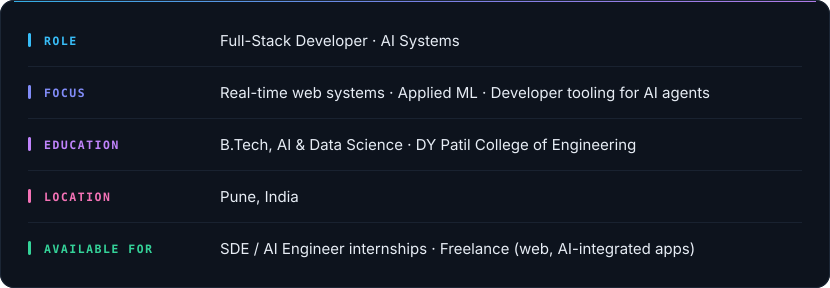
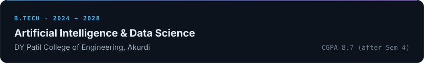

  

  
  &nbsp;
  

 

  

 

  
  

  
  

  
  

  Source code: <a href="https://github.com/aryanpol73/LBPLCricket">LBPL Cricket App</a> &nbsp;·&nbsp; <a href="https://github.com/aryanpol73/perigee">Perigee</a> &nbsp;·&nbsp; <a href="https://github.com/aryanpol73/conflux">CONFLUX</a> &nbsp;·&nbsp; <a href="https://github.com/aryanpol73/fence">FENCE</a> &nbsp;·&nbsp; <a href="https://github.com/aryanpol73/strata">Strata</a> &nbsp;·&nbsp; <a href="https://github.com/aryanpol73/FRAME">FRAME</a>

 

  

 

  

 

  
  &nbsp;
  

  

